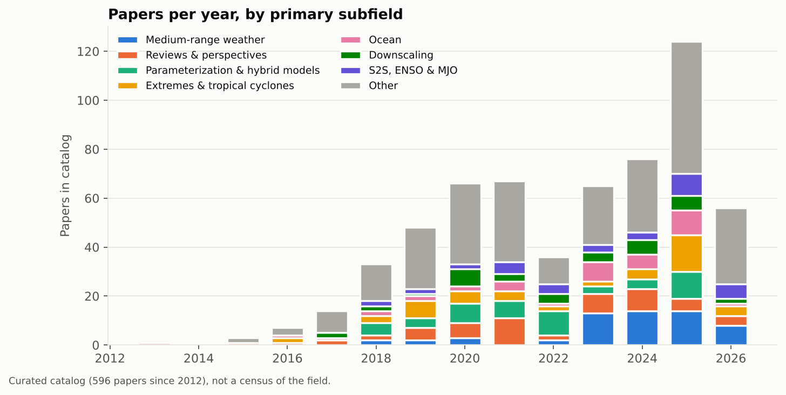
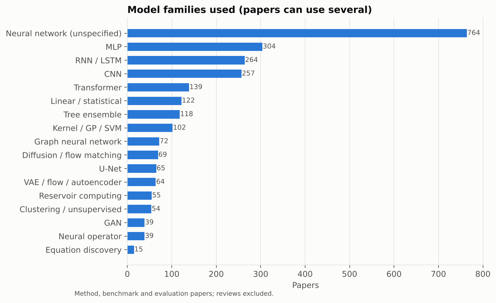
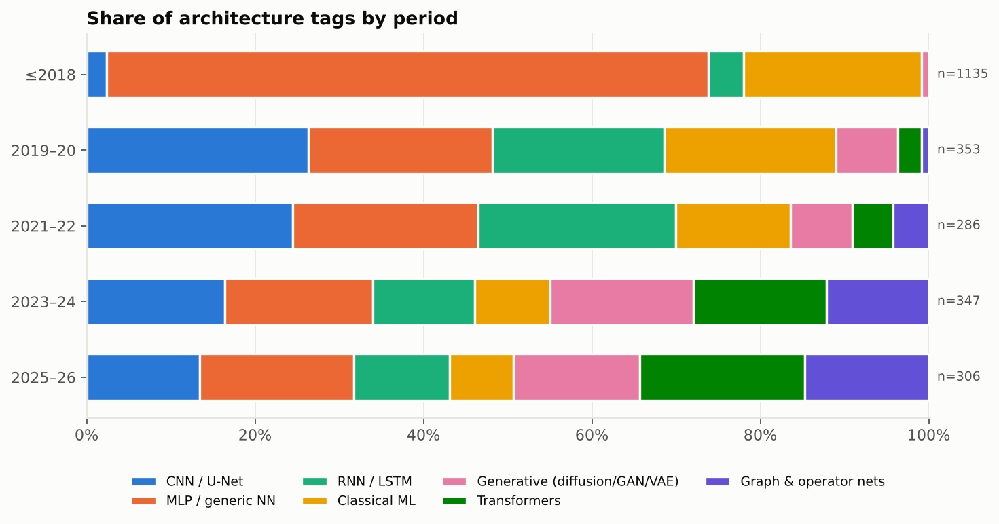
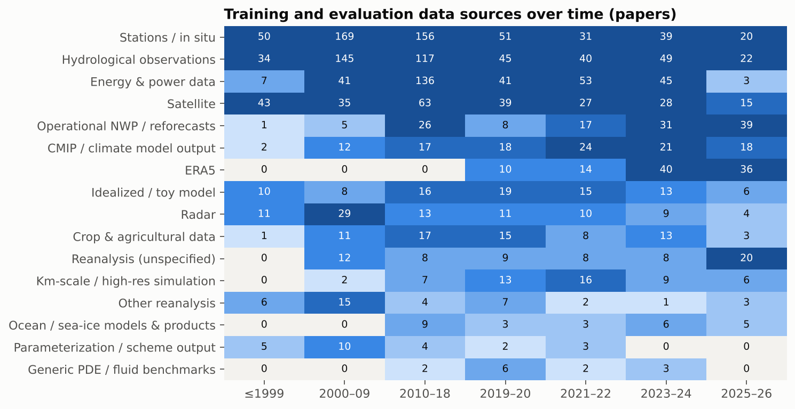
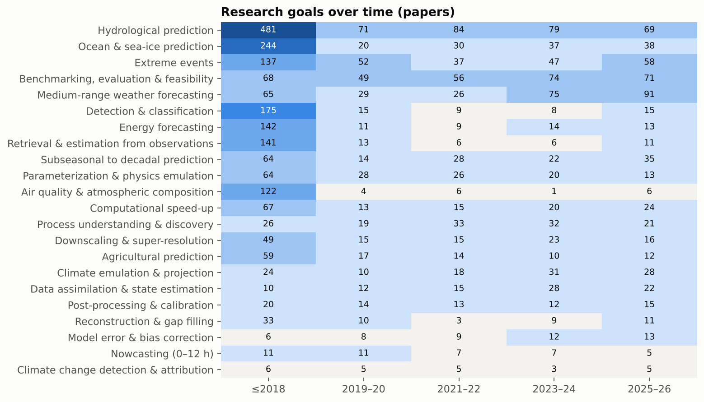
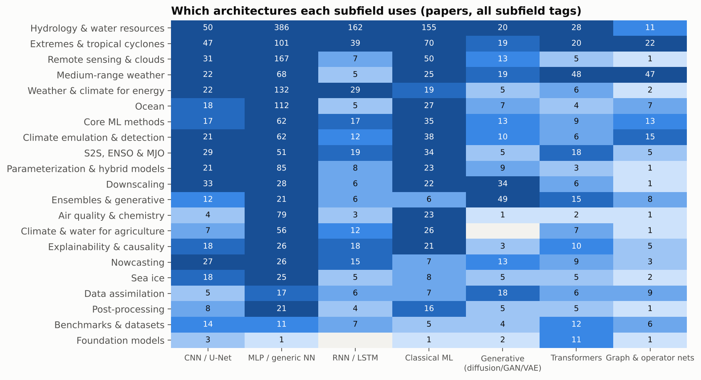
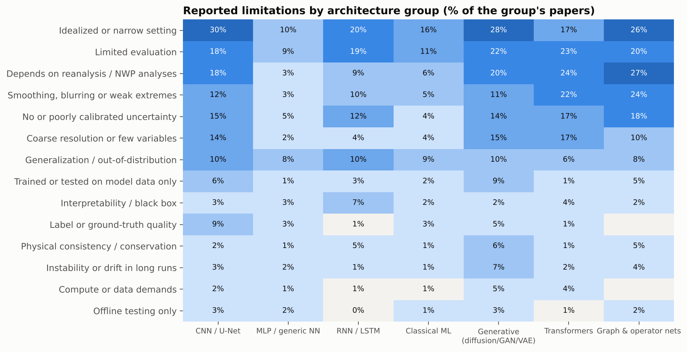
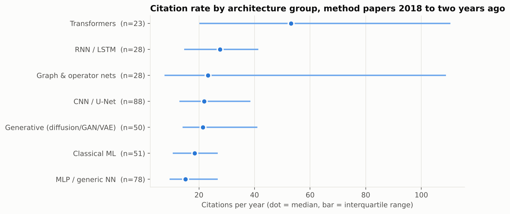
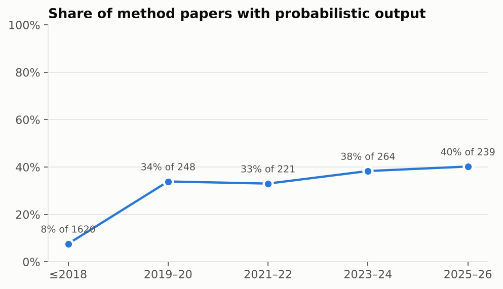
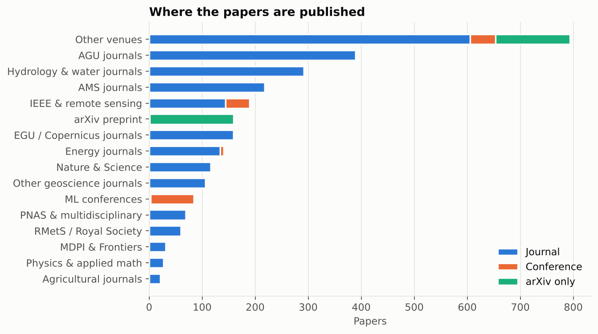

# Exploratory analysis of the catalog

Built from `data/papers.duckdb` by [`analysis/eda.py`](eda.py), which also writes this report, so every number below matches the current catalog. Every figure has its data in [`analysis/tables/`](tables/).

**Interactive version.** Open [`eda.html`](../eda.html), the interactive EDA page with guided views, or the **Insights** tab of [`index.html`](../index.html). Every chart there recalculates for the current selection: search, subfield, years, and any number of "Slice by" filters (architecture, goal, data source, limitation, open problem, venue…). It includes:
- a timeline of when each architecture, goal or data source first appeared
- trends by year
- what is rising and what is fading since 2022
- citation impact by group
- a cross-tab explorer for any two categories
- the recurring limitations and open problems, with quotes from the most-cited papers

**Read this first.** This is a curated catalog of 2857 papers (1980–2026), not a census of the field. It over-represents landmark and highly cited work. Recent years are covered (2025: 189, 2026: 100 papers); the most recent papers have had little time to accumulate citations. The trends below describe the catalog. They point in the direction the field has moved, but the percentages are not field-wide estimates. Categories come from keyword rules applied to the structured summaries (see [Categories](#categories)), so a paper is tagged by what its summary says.

## Headlines

1. **The architecture mix has turned over.** Transformers, graph/operator networks and generative models were 11% of architecture tags in 2019–20 and 49% in 2025–26. CNN/U-Net went from 26% to 13% over the same periods.
2. **Operational NWP / reforecasts is now the most common data source, ahead of ERA5.** ERA5 appears in 13 papers in 2019–20 and 54 in 2025–26, where it is used by 20% of method papers. Idealized and toy-model studies (Lorenz-96, quasi-geostrophic turbulence, aquaplanets) went from 32 papers in 2021–22 to 9 in 2025–26.
3. **Probabilistic output keeps growing.** Share of method papers producing ensembles, distributions or other uncertainty: 8% (≤2018), 34% (2019–20), 33% (2021–22), 38% (2023–24), 40% (2025–26).
4. **Goals have shifted.** Hydrological prediction is the most common goal overall (784 papers). Comparing papers from 2019–20 and 2021–22 with papers from 2023–24 and 2025–26, the fastest-growing goals are Medium-range weather forecasting (+17 pts), Benchmarking, evaluation & feasibility (+5 pts), Climate emulation & projection (+5 pts); the largest declines are Hydrological prediction (-3 pts), Parameterization & physics emulation (-4 pts).
5. **Subfields keep distinct architecture signatures.** Dominant group per subfield: Hydrology & water resources: MLP / generic NN (386 of 690 papers); Extremes & tropical cyclones: MLP / generic NN (101 of 258 papers); Remote sensing & clouds: MLP / generic NN (167 of 246 papers); Weather & climate for energy: MLP / generic NN (132 of 185 papers); Medium-range weather: MLP / generic NN (68 of 184 papers); Ocean: MLP / generic NN (112 of 165 papers); Climate emulation & detection: MLP / generic NN (62 of 143 papers); Parameterization & hybrid models: MLP / generic NN (85 of 123 papers).
6. **Each architecture family has its own typical weakness.** Besides narrow or idealized test settings, which affect every group, the most frequent limitation per group is: MLP / generic NN: Limited evaluation (9%); Classical ML: Limited evaluation (11%); CNN / U-Net: Limited evaluation (18%); RNN / LSTM: Limited evaluation (19%); Generative (diffusion/GAN/VAE): Limited evaluation (22%); Transformers: Depends on reanalysis / NWP analyses (24%); Graph & operator nets: Depends on reanalysis / NWP analyses (27%). The most common open problems across all papers are Generalization & transfer (246), Operational use (241), Probabilistic forecasts & uncertainty (228).
7. **Citation rates.** Among method papers from 2018–2024, which have had time to collect citations, median citations per year are Graph & operator nets 20 (n=50), RNN / LSTM 19 (n=178), Transformers 17 (n=69), Classical ML 16 (n=145), Generative (diffusion/GAN/VAE) 15 (n=104), CNN / U-Net 15 (n=208), MLP / generic NN 14 (n=209). The leaders are carried by a few flagship models, and the interquartile ranges are wide and overlap. Papers from 2025 on are too recent to compare this way.

## Figures

### Papers per year

The busiest years in the catalog are 2025 (189 papers) and 2020 (174).

### Model families

Neural network (unspecified) is the most common family (764 papers), followed by MLP (304) and RNN / LSTM (264). "Neural network (unspecified)" (764) mostly covers dense networks whose summaries don't name the layer type. Approaches that sit on top of a model are tagged separately and excluded from this chart: hybrid physics-ML coupling (180), data-assimilation schemes (37), XAI methods (51) and physics-informed constraints (53).

### Architecture shift

| Period | Tags | CNN / U-Net | MLP / generic | RNN / LSTM | Classical ML | Generative | Transformers | Graph & operator |
|---|---:|---:|---:|---:|---:|---:|---:|---:|
| ≤2018 | 1135 | 2% | 71% | 4% | 21% | 1% | 0% | 0% |
| 2019–20 | 353 | 26% | 22% | 20% | 20% | 7% | 3% | 1% |
| 2021–22 | 286 | 24% | 22% | 23% | 14% | 7% | 5% | 4% |
| 2023–24 | 347 | 16% | 18% | 12% | 9% | 17% | 16% | 12% |
| 2025–26 | 306 | 13% | 18% | 11% | 8% | 15% | 20% | 15% |

### Data sources

CMIP and other climate-model output appears in 26, 27, 35, 47, 34 papers across the periods (≤2018, 2019–20, 2021–22, 2023–24, 2025–26); it is used for emulation, detection and transfer learning. Operational NWP archives and reforecasts grow alongside ERA5 (15, 15, 24, 48, 64), because ML weather models are verified against and fine-tuned on operational analyses.

### Research goals over time

### Architecture by subfield

### Limitations by architecture

Each cell is the share of a group's papers whose summary reports that limitation. Limitations come from the summaries, and many are an editorial assessment rather than the authors' own statement.

### Citation rate by architecture

Method papers from 2018 to 2024. Citations per year are total citations divided by years since publication (minimum one year); more recent papers are left out because they have not had time to be cited. Compare medians, not means.

### Probabilistic output

### Venues

The main homes of the catalog's papers are Other venues (794), AGU journals (389), Hydrology & water journals (292). ML conferences account for 84 papers, and 159 exist only on arXiv.

## Journals

Venues with at least 5 papers in the catalog, ranked by **impact index**: the median, over a venue's papers, of
citations per year relative to the median for catalog papers from the same year (1 = typical). **Top 10%** is the
share of its papers among the most cited for their year. These describe each venue's papers in this catalog, not
the journal as a whole, and are not the Journal Impact Factor. The interactive version, with filters, trends and
each venue's most influential papers, is [`journals.html`](../journals.html).

| Venue | Group | Papers | Impact index | Top 10% | Median cites/yr | Tier |
|---|---|---:|---:|---:|---:|---|
| Nature | Nature & Science | 15 | 12.06 | 80% | 176.4 | Leading |
| IEEE Transactions on Power Systems | Energy journals | 20 | 6.56 | 75% | 8.1 | Leading |
| IEEE Trans. Neural Networks | IEEE & remote sensing | 5 | 5.25 | 80% | 6.6 | Leading |
| Agricultural Water Management | Agricultural journals | 5 | 4.00 | 60% | 14.0 | Leading |
| Hydrological Sciences Journal-journal Des Sciences Hydrologiques | Hydrology & water journals | 8 | 3.92 | 50% | 5.5 | Leading |
| IEEE transactions on energy conversion | Energy journals | 6 | 3.58 | 50% | 16.3 | Leading |
| Nature Climate Change | Nature & Science | 5 | 3.50 | 40% | 35.2 | Leading |
| ICLR | ML conferences | 6 | 3.02 | 50% | 45.4 | Leading |
| Communications Earth & Environment | Nature & Science | 6 | 2.83 | 33% | 24.0 | Leading |
| Nature Machine Intelligence | Nature & Science | 6 | 2.78 | 33% | 40.8 | Leading |
| Radio Science | Other venues | 6 | 2.72 | 33% | 6.0 | Leading |
| PNAS | PNAS & multidisciplinary | 15 | 2.67 | 27% | 32.4 | Leading |
| Applied Energy | Energy journals | 17 | 2.63 | 12% | 13.8 | Strong |
| Climate Research | Other venues | 5 | 2.60 | 40% | 4.4 | Leading |
| Energy Conversion and Management | Energy journals | 8 | 2.53 | 12% | 10.3 | Strong |
| Nature Communications | Nature & Science | 22 | 2.49 | 32% | 34.4 | Leading |
| Advances in Water Resources | Hydrology & water journals | 7 | 2.36 | 14% | 12.9 | Strong |
| Journal of Irrigation and Drainage Engineering-asce | Other venues | 8 | 2.20 | 12% | 9.1 | Strong |
| ICML | ML conferences | 12 | 2.14 | 42% | 25.1 | Leading |
| Renewable Energy | Energy journals | 36 | 2.09 | 17% | 11.6 | Strong |
| Water Resources Management | Hydrology & water journals | 17 | 2.06 | 12% | 5.8 | Strong |
| Applied Soft Computing | Other venues | 6 | 2.04 | 17% | 19.3 | Strong |
| Journal of Hydrologic Engineering | Other venues | 38 | 2.01 | 18% | 6.9 | Strong |
| Energy | Energy journals | 8 | 1.93 | 12% | 7.8 | Strong |
| Engineering applications of artificial intelligence | Other venues | 8 | 1.92 | 12% | 8.0 | Strong |
| Journal of Water Resources Planning and Management | Other venues | 12 | 1.90 | 33% | 5.0 | Leading |
| Atmospheric Chemistry and Physics | EGU / Copernicus journals | 6 | 1.74 | 17% | 22.9 | Strong |
| Renewable & Sustainable Energy Reviews | Energy journals | 7 | 1.67 | 14% | 18.0 | Strong |
| Solar Energy | Energy journals | 22 | 1.63 | 14% | 11.0 | Strong |
| Agricultural and Forest Meteorology | Agricultural journals | 8 | 1.57 | 12% | 27.6 | Strong |
| Ocean Engineering | Other venues | 17 | 1.57 | 6% | 5.6 | Strong |
| Journal of Hydrology | Hydrology & water journals | 141 | 1.56 | 11% | 11.6 | Strong |
| Atmospheric Environment | Other geoscience journals | 19 | 1.55 | 11% | 4.5 | Strong |
| Environmental Modelling & Software | Other geoscience journals | 27 | 1.53 | 11% | 8.0 | Strong |
| Science of the Total Environment | Other venues | 8 | 1.42 | 0% | 8.7 | Strong |
| Hydrology and Earth System Sciences | EGU / Copernicus journals | 93 | 1.41 | 10% | 12.0 | Strong |
| Neurocomputing | Other venues | 16 | 1.41 | 0% | 5.5 | Strong |
| Journal of Computational Physics | Physics & applied math | 6 | 1.37 | 17% | 22.4 | Strong |
| Expert systems with applications | Other venues | 7 | 1.32 | 0% | 5.7 | Strong |
| Geoscientific Model Development | EGU / Copernicus journals | 33 | 1.28 | 3% | 16.0 | Strong |
| CVPR | ML conferences | 6 | 1.26 | 0% | 15.7 | Strong |
| Journal of Applied Meteorology and Climatology | AMS journals | 30 | 1.24 | 20% | 3.7 | Strong |
| Hydrological Sciences Journal | Hydrology & water journals | 31 | 1.24 | 6% | 5.2 | Strong |
| Journal of Computing in Civil Engineering | Other venues | 6 | 1.23 | 17% | 1.4 | Strong |
| Philosophical Transactions of the Royal Society A | RMetS / Royal Society | 12 | 1.23 | 17% | 19.2 | Strong |
| JAWRA Journal of the American Water Resources Association | Other venues | 10 | 1.22 | 0% | 4.0 | Strong |
| Computers and Electronics in Agriculture | Agricultural journals | 6 | 1.11 | 17% | 13.6 | Strong |
| Journal of Hydrometeorology | AMS journals | 20 | 1.10 | 0% | 7.2 | Strong |
| npj Climate and Atmospheric Science | Nature & Science | 27 | 1.08 | 7% | 10.0 | Strong |
| Water Resources Research | AGU journals | 131 | 1.08 | 14% | 9.2 | Strong |
| Water | Hydrology & water journals | 12 | 1.07 | 25% | 18.3 | Strong |
| Environmental Data Science | Other geoscience journals | 7 | 1.03 | 0% | 13.6 | Strong |
| Scientific Reports | PNAS & multidisciplinary | 11 | 1.03 | 0% | 17.1 | Strong |
| Hydrological Processes | Hydrology & water journals | 50 | 1.03 | 2% | 4.6 | Strong |
| Journal of Climate | AMS journals | 28 | 1.01 | 7% | 4.0 | Strong |
| Ecological Modelling | Other venues | 10 | 1.00 | 10% | 3.4 | Strong |
| IEEE Transactions on Geoscience and Remote Sensing | IEEE & remote sensing | 63 | 1.00 | 5% | 3.8 | Strong |
| Science Advances | Nature & Science | 21 | 1.00 | 19% | 12.8 | Strong |
| NeurIPS | ML conferences | 36 | 1.00 | 14% | 12.0 | Strong |
| JGR (section not recorded) | AGU journals | 45 | 1.00 | 7% | 3.5 | Strong |
| Hydrology Research | Hydrology & water journals | 8 | 0.95 | 0% | 4.4 | Steady |
| Journal of Atmospheric and Oceanic Technology | AMS journals | 24 | 0.94 | 0% | 4.1 | Steady |
| Climate Dynamics | Other geoscience journals | 23 | 0.93 | 4% | 3.8 | Steady |
| Quarterly Journal of the Royal Meteorological Society | RMetS / Royal Society | 12 | 0.93 | 8% | 6.8 | Steady |
| Remote Sensing of Environment | IEEE & remote sensing | 16 | 0.91 | 12% | 3.5 | Steady |
| Transactions of the ASABE | Other venues | 7 | 0.89 | 0% | 1.4 | Steady |
| Advances in Engineering Software | Other venues | 9 | 0.85 | 0% | 3.0 | Steady |
| Journal of Hydroinformatics | Hydrology & water journals | 14 | 0.84 | 0% | 3.4 | Steady |
| Atmosphere | MDPI & Frontiers | 7 | 0.84 | 14% | 14.3 | Steady |
| Geophysical Research Letters | AGU journals | 76 | 0.81 | 1% | 8.6 | Steady |
| Weather and Forecasting | AMS journals | 35 | 0.78 | 9% | 3.8 | Steady |
| Environmental Research Letters | PNAS & multidisciplinary | 33 | 0.77 | 0% | 12.3 | Steady |
| International Journal of Climatology | RMetS / Royal Society | 24 | 0.76 | 8% | 2.8 | Steady |
| Neural computing & applications (Print) | Other venues | 7 | 0.75 | 0% | 1.3 | Steady |
| The Cryosphere | EGU / Copernicus journals | 6 | 0.75 | 0% | 8.9 | Steady |
| Chaos | Physics & applied math | 7 | 0.75 | 0% | 12.5 | Steady |
| Atmospheric Research | Other geoscience journals | 7 | 0.75 | 14% | 16.1 | Steady |
| Theoretical and Applied Climatology | Other geoscience journals | 7 | 0.72 | 0% | 8.1 | Steady |
| Neural Networks | Other venues | 10 | 0.72 | 10% | 3.1 | Steady |
| AAAI | ML conferences | 9 | 0.71 | 0% | 10.8 | Steady |
| Artificial Intelligence for the Earth Systems | AMS journals | 34 | 0.70 | 3% | 5.9 | Steady |
| Journal of Advances in Modeling Earth Systems | AGU journals | 110 | 0.70 | 3% | 10.0 | Steady |
| Bulletin of the American Meteorological Society | AMS journals | 20 | 0.70 | 15% | 9.1 | Steady |
| Chemosphere | Other venues | 5 | 0.69 | 0% | 3.3 | Steady |
| Monthly Weather Review | AMS journals | 25 | 0.68 | 0% | 7.2 | Steady |
| Preprint | Other venues | 48 | 0.56 | 6% | 1.2 | Lower impact |
| International Journal of Remote Sensing | Other venues | 29 | 0.56 | 7% | 1.3 | Lower impact |
| Meteorological Applications | RMetS / Royal Society | 7 | 0.52 | 0% | 2.4 | Lower impact |
| IEEE International Geoscience and Remote Sensing Symposium | IEEE & remote sensing | 10 | 0.50 | 0% | 0.9 | Lower impact |
| Earth's Future | AGU journals | 13 | 0.50 | 8% | 4.0 | Lower impact |
| Remote Sensing | MDPI & Frontiers | 9 | 0.50 | 0% | 6.1 | Lower impact |
| Journal of the Air and Waste Management Association | Other venues | 9 | 0.49 | 0% | 1.4 | Lower impact |
| Nonlinear Processes in Geophysics | EGU / Copernicus journals | 9 | 0.42 | 0% | 4.6 | Lower impact |
| KDD | ML conferences | 11 | 0.38 | 0% | 7.2 | Lower impact |
| IEEE Geoscience and Remote Sensing Letters | IEEE & remote sensing | 5 | 0.32 | 0% | 7.0 | Lower impact |
| IGARSS '98. Sensing and Managing the Environment. 1998 IEEE International Geoscience and Remote Sensing. Symposium Proceedings. (Cat. No.98CH36174) | IEEE & remote sensing | 7 | 0.17 | 0% | 0.4 | Lower impact |

## Categories

| Dimension | Values | Where it comes from |
|---|---|---|
| `paper_type` | method, review, dataset_benchmark, evaluation | summary architecture/goal text and title |
| model family (`paper_architecture`, `tag_kind = 'model_family'`) | CNN, U-Net, RNN/LSTM, MLP, Transformer, GNN, neural operator, diffusion, GAN, VAE/flow/autoencoder, tree ensemble, kernel/GP/SVM, linear/statistical, reservoir computing, clustering, equation discovery, neural network (unspecified) | summary architecture field and title |
| approach (`tag_kind = 'approach'`) | hybrid physics-ML, physics-informed constraints, causal/XAI, data-assimilation scheme | same |
| `arch_group` | 7 coarse groups used in trend plots | mapping in `scripts/taxonomy.py` |
| data source (`paper_data_source`) | ERA5, other/unspecified reanalysis, CMIP/climate models, km-scale simulations, idealized models, operational NWP, radar, satellite, stations/in situ, ocean/sea-ice products, scheme output, generic PDE benchmarks | summary data field |
| goal (`paper_task`) | research goals, e.g. medium-range forecasting, parameterization, downscaling, detection & attribution | summary goal field and title |
| limitation (`paper_issue_theme`) | recurring limitation themes, e.g. idealized setting, reanalysis dependence, blurring, no uncertainty, instability | summary issues field |
| open problem (`paper_open_theme`) | research-agenda themes, e.g. probabilistic forecasts, operational use, online coupling, learning from observations | summary open-work field |
| `probabilistic` | true/false | summary architecture/goal/result and title |
| `venue_family` | publisher/community groups | venue string |
| period | ≤2018, 2019–20, 2021–22, 2023–24, 2025–26 | `PERIODS` in `scripts/taxonomy.py` |

**Fixing a category.** For one paper, add a row to `data/category_overrides.csv` (`paper_id,dimension,label,action,note`, where action is `add`, `remove` or `set`). For a systematic problem, edit the regex in `scripts/taxonomy.py`. Then rerun `python3 scripts/build_db.py && python3 analysis/eda.py`. 3 manual corrections are applied.

**Known limitations.** The rules can only see what the summaries say. 571 summaries are partly editorial assessments, and 1582 papers had no abstract available. Multi-label tagging means a paper using a U-Net inside a diffusion model counts under both families.
